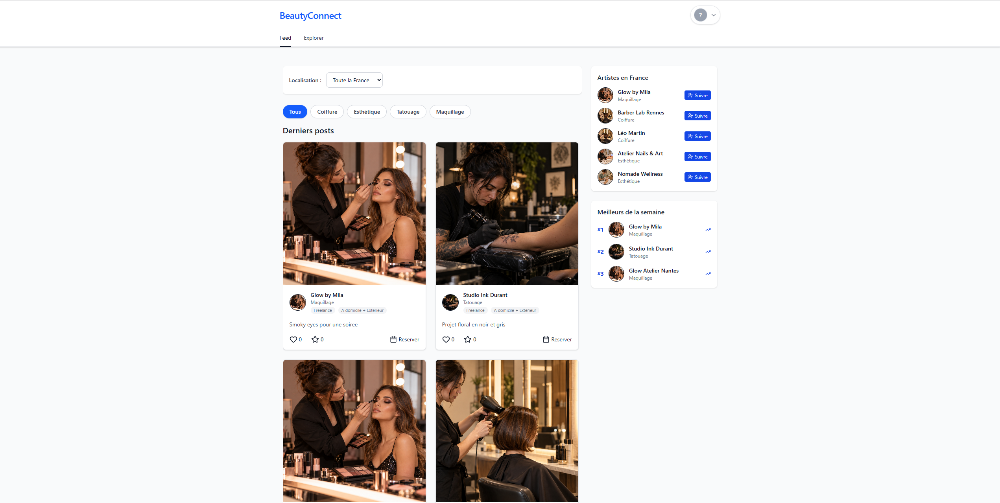
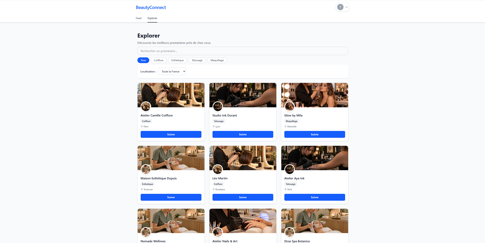
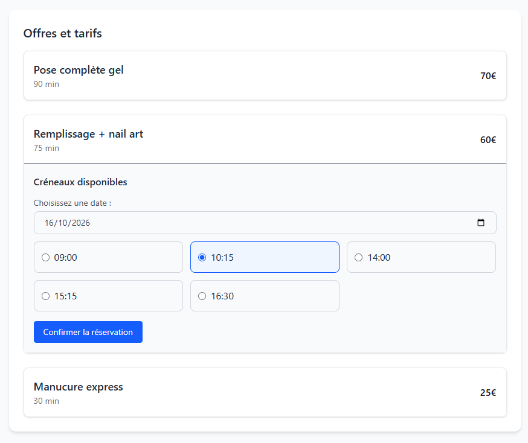
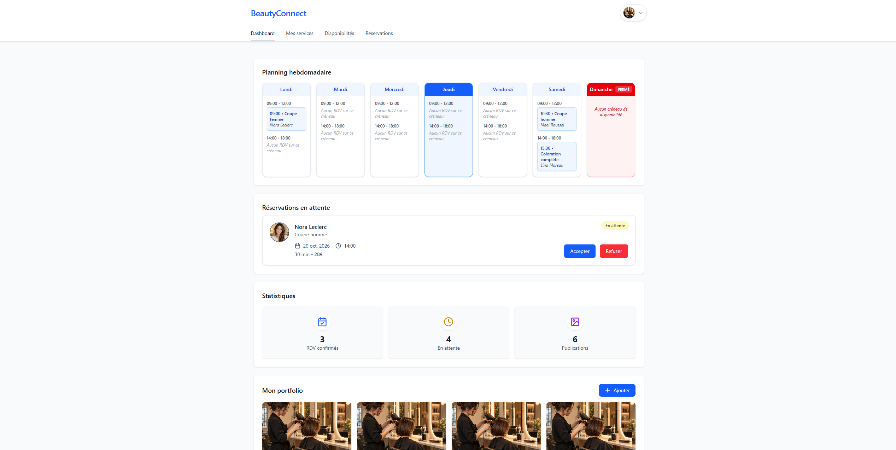

# 💄 BeautyConnect

### Plateforme de mise en relation entre professionnels de la beauté et clients

[](https://github.com/CamFav/beautyconnect/actions/workflows/ci-docker.yml)
[](https://react.dev/)
[](https://nodejs.org/)
[](https://expressjs.com/)
[](https://www.mongodb.com/)
[](https://www.docker.com/)
[](https://github.com/CamFav/beautyconnect/actions)

> **BeautyConnect** est une application web full-stack qui facilite la mise en relation entre les professionnels de la beauté et leurs clients.
>
> Elle réunit la découverte de prestataires, la consultation des services et tarifs, la prise de rendez-vous, la gestion des disponibilités et le partage de publications au sein d'une même plateforme.

Le projet repose sur une interface **React 19**, une API REST développée avec **Node.js / Express**, une base de données **MongoDB / Mongoose** et une infrastructure conteneurisée avec **Docker Compose**.

BeautyConnect propose deux parcours complémentaires : un espace client pour découvrir et réserver des prestations, et un espace professionnel pour gérer son activité.

---

## 🎯 Objectifs

BeautyConnect répond à plusieurs besoins du secteur de la beauté :

- **Faciliter la découverte** de professionnels selon leur spécialité et leur localisation.
- **Centraliser les prestations** avec leurs tarifs et leurs durées.
- **Simplifier la réservation** de rendez-vous en ligne.
- **Aider les professionnels** à organiser leurs disponibilités et leurs réservations.
- **Valoriser leur travail** grâce aux profils, portfolios et publications.
- **Favoriser les interactions** entre clients et prestataires.
- **Proposer une expérience cohérente** aux deux types d'utilisateurs.

---

## 📸 Aperçu de l'application

Les captures suivantes proviennent de l'application exécutée localement avec un jeu de données de démonstration.

### 🏠 Fil d'actualité

Consultation des publications des professionnels, filtrage par spécialité et découverte de nouveaux prestataires.



### 🔎 Explorer les professionnels

Recherche et découverte des prestataires avec filtres par activité et localisation.



### 👤 Profil professionnel

Présentation d'un prestataire avec ses informations, ses prestations, ses tarifs et ses dernières publications.


### 📅 Prise de rendez-vous

Sélection d'une prestation, consultation des créneaux disponibles et réservation d'un rendez-vous.



### 📊 Tableau de bord professionnel

Vue du planning hebdomadaire, des réservations en attente, des statistiques et du portfolio.



---

## ✨ Fonctionnalités

| Module | Fonctionnalités |
|---|---|
| **Authentification** | Inscription, connexion et authentification JWT |
| **Comptes utilisateurs** | Gestion du profil et suppression de compte |
| **Profils professionnels** | Présentation de l'activité et informations du prestataire |
| **Explorer** | Recherche de professionnels par spécialité et localisation |
| **Prestations** | Consultation des services, durées et tarifs |
| **Disponibilités** | Gestion des plages horaires des professionnels |
| **Réservations** | Sélection de prestations et de créneaux disponibles |
| **Gestion des rendez-vous** | Consultation, acceptation et refus des demandes |
| **Fil d'actualité** | Consultation des publications des professionnels |
| **Interactions sociales** | Likes, favoris et abonnements |
| **Portfolio** | Présentation des réalisations et publications |
| **Tableau de bord** | Planning, réservations et indicateurs d'activité |

### Parcours client

Le client peut :

1. Découvrir des professionnels sur le fil d'actualité ou dans Explorer.
2. Filtrer les résultats par spécialité ou localisation.
3. Consulter le profil d'un prestataire.
4. Comparer ses prestations, durées et tarifs.
5. Sélectionner une prestation et un créneau disponible.
6. Effectuer une demande de réservation.
7. Retrouver ses interactions et ses réservations dans son espace.

### Parcours professionnel

Le professionnel dispose d'un espace dédié pour :

1. Présenter son activité et ses prestations.
2. Configurer ses disponibilités.
3. Consulter son planning hebdomadaire.
4. Examiner les demandes de réservation.
5. Accepter ou refuser les rendez-vous.
6. Publier des contenus et enrichir son portfolio.
7. Consulter les indicateurs de son activité.

---

## 🚀 Stack technique

### Frontend

- **React 19** — bibliothèque d'interface utilisateur.
- **JavaScript / JSX** — développement des composants.
- **Vite 7** — serveur de développement et compilation.
- **Tailwind CSS 4** — styles et interface responsive.
- **React Router** — navigation.
- **Axios** — communication avec l'API REST.
- **Lucide React** — bibliothèque d'icônes.
- **date-fns** — manipulation des dates.
- **Vitest / Testing Library** — tests frontend.

### Backend

- **Node.js 20** — environnement d'exécution JavaScript.
- **Express 4** — API REST.
- **MongoDB** — base de données documentaire.
- **Mongoose** — modélisation et accès aux données.
- **JSON Web Tokens (JWT)** — authentification.
- **bcrypt / bcryptjs** — hachage des mots de passe.
- **express-validator** — validation des requêtes.
- **Helmet, CORS et express-rate-limit** — protections HTTP.
- **Cloudinary** — intégration optionnelle pour l'envoi d'images.
- **Jest / Supertest** — tests backend.

### DevOps et infrastructure

- **Docker / Docker Compose** — conteneurisation des services.
- **GitHub Actions** — intégration continue.
- **Git / GitHub** — gestion de versions.
- **MongoDB 6** — service de base de données utilisé par l'environnement Docker.

---

## 🏗️ Architecture

BeautyConnect adopte une architecture client-serveur reposant sur une API REST.

```text
                    ┌───────────────────────┐
                    │    Client / Navigateur│
                    └───────────┬───────────┘
                                │
                                ▼
                    ┌───────────────────────┐
                    │   Frontend React      │
                    │   Vite / Tailwind CSS │
                    └───────────┬───────────┘
                                │ HTTP / JSON
                                ▼
                    ┌───────────────────────┐
                    │   API Node.js         │
                    │   Express / JWT       │
                    └───────────┬───────────┘
                                │
                                ▼
                    ┌───────────────────────┐
                    │   MongoDB             │
                    │   Mongoose            │
                    └───────────────────────┘
```

### Organisation du dépôt

```text
beautyconnect/
│
├── backend/
│   ├── config/              # Configuration des services
│   ├── controllers/         # Logique des opérations métier
│   ├── middleware/          # Authentification et validations
│   ├── models/              # Modèles Mongoose
│   ├── routes/              # Routes de l'API REST
│   ├── seed/
│   │   ├── assets/          # Images locales de démonstration
│   │   ├── images.json
│   │   └── seed.js
│   ├── __tests__/           # Tests backend
│   ├── .env.example
│   ├── Dockerfile
│   ├── app.js
│   ├── server.js
│   └── package.json
│
├── frontend/
│   ├── src/                 # Composants, pages et fonctionnalités
│   ├── .env.example
│   ├── Dockerfile
│   └── package.json
│
├── docs/
│   └── screenshots/
│       ├── 01-feed.png
│       ├── 02-explorer.png
│       ├── 03-profil-professionnel.png
│       ├── 04-reservation.png
│       └── 05-dashboard-professionnel.png
│
├── .github/
│   └── workflows/
│       └── ci-docker.yml
│
├── docker-compose.yml
├── docker-compose.prod.yml
├── .gitignore
└── README.md
```

### Responsabilités des composants

| Composant | Responsabilité |
|---|---|
| **Frontend** | Interface utilisateur et interactions avec l'API |
| **Routes Express** | Définition des points d'entrée HTTP |
| **Controllers** | Traitement des requêtes et opérations métier |
| **Middleware** | Authentification, validation et contrôles d'accès |
| **Models Mongoose** | Définition des données et accès à MongoDB |
| **MongoDB** | Persistance des utilisateurs, publications et réservations |
| **Docker Compose** | Orchestration de l'environnement local |

---

## 🛠️ Installation locale

### Prérequis

- Git
- Docker Desktop ou Docker Engine
- Docker Compose

L'environnement Docker permet de démarrer le frontend, le backend et MongoDB sans installation manuelle des dépendances Node.js sur la machine hôte.

### 1. Cloner le dépôt

```bash
git clone https://github.com/CamFav/beautyconnect.git
cd beautyconnect
```

### 2. Préparer la configuration

Créer le fichier de configuration du backend à partir de l'exemple.

**Windows / PowerShell :**

```powershell
Copy-Item backend/.env.example backend/.env
```

**Linux / macOS :**

```bash
cp backend/.env.example backend/.env
```

Exemple de configuration pour le développement :

```dotenv
NODE_ENV=development
PORT=5000
MONGO_URL=mongodb://localhost:27017/beautyconnect
JWT_SECRET=replace_with_a_long_local_secret
CORS_ORIGINS=http://localhost:5173,http://127.0.0.1:5173
```

Le fichier Docker Compose configure la connexion entre les conteneurs et utilise le service MongoDB interne.

Remplacer la valeur d'exemple de `JWT_SECRET` par une valeur locale suffisamment longue et aléatoire.

> ⚠️ Ne jamais versionner les fichiers `.env` contenant des informations sensibles. Les fichiers `.env.example` servent uniquement de modèles.

### 3. Démarrer les services

Depuis la racine du projet :

```bash
docker compose up -d --build
```

Vérifier leur état :

```bash
docker compose ps
```

L'environnement démarre :

1. **MongoDB** — stockage des données.
2. **Backend Express** — API REST.
3. **Frontend React / Vite** — interface utilisateur.

### 4. Accéder à l'application

| Service | Adresse |
|---|---|
| Application web | http://localhost:5173 |
| API REST | http://localhost:5000/api |
| Health check | http://localhost:5000/api/health |
| MongoDB local | `localhost:27017` |

### 5. Arrêter les services

```bash
docker compose down
```

Cette commande arrête les conteneurs sans supprimer les volumes persistants.

> ⚠️ Éviter `docker compose down -v` si vous souhaitez conserver les données MongoDB locales.

---

## 🧪 Données de démonstration

BeautyConnect dispose d'un script permettant de générer un environnement de démonstration représentatif des fonctionnalités de l'application.

### Initialiser les données

Une fois les conteneurs démarrés :

```bash
docker compose exec backend npm run seed
```

Le script prépare notamment :

- Des comptes clients et professionnels.
- Des profils de prestataires.
- Des prestations et leurs tarifs.
- Des disponibilités hebdomadaires.
- Des publications et interactions.
- Des réservations avec différents statuts.

### Comptes de démonstration

| Rôle | Identifiant | Mot de passe |
|---|---|---|
| Professionnel | `camille.bernard@demo.local` | `Password123!` |
| Client | `lucas.petit@demo.local` | `Password123!` |

Ces identifiants sont destinés uniquement à l'environnement de démonstration local.

### Images de démonstration

Les images utilisées pour les données de démonstration sont intégrées directement au dépôt :

```text
backend/seed/assets/
├── client.png
├── coiffure.png
├── esthetique.png
├── maquillage.png
├── onglerie.png
└── tatouage.png
```

Elles sont servies en développement via `/demo-assets`.

Cette approche permet d'afficher des contenus cohérents avec les différents métiers sans dépendre de services externes d'images.

### Précautions

Le script de seed est réservé au développement local.

Il refuse les connexions de production, les connexions MongoDB Atlas et les hôtes MongoDB non locaux.

Il remplace uniquement les données de démonstration identifiées par le domaine `@demo.local`, sans supprimer l'ensemble de la base de données.

---

## 💻 Développement

### Frontend

```bash
cd frontend

npm ci --legacy-peer-deps
npm run dev
```

Vérification du code :

```bash
npm run lint
npm run test
npm run build
```

### Backend

```bash
cd backend

npm ci
npm run dev
```

Exécution des tests :

```bash
npm test
```

Pour exécuter le backend en dehors de Docker, une instance MongoDB locale doit être accessible et le fichier `backend/.env` correctement configuré.

### Configuration des médias

Cloudinary est une intégration optionnelle utilisée pour les fonctionnalités d'envoi d'images.

Les variables nécessaires sont :

```dotenv
CLOUDINARY_CLOUD_NAME=
CLOUDINARY_API_KEY=
CLOUDINARY_API_SECRET=
```

La navigation et les contenus de démonstration locaux ne nécessitent pas de compte Cloudinary.

---

## 🧪 Tests et qualité

Le projet comprend des tests automatisés frontend et backend.

| Composant | Outils | Vérifications |
|---|---|---|
| **Frontend** | Vitest, Testing Library | Tests de composants et de logique applicative |
| **Backend** | Jest, Supertest | Tests de routes et de modules |
| **Compilation** | Vite | Construction du frontend |
| **Infrastructure** | Docker Compose | Validation de configuration et construction des images |

### Tests frontend

```bash
cd frontend
npm run test
npm run build
```

### Tests backend

```bash
cd backend
npm test
```

Les tests backend utilisent notamment `mongodb-memory-server` pour les scénarios nécessitant une base MongoDB isolée.

Certains environnements restreints peuvent empêcher le téléchargement du binaire MongoDB nécessaire aux tests.

> **État des vérifications locales :** les tests frontend, la compilation Vite et une sélection de tests backend ont été validés lors de la préparation du projet. La réussite de l'intégralité de la suite backend n'est pas certifiée.

---

## 🔌 API REST

Le backend Express expose les principales fonctionnalités de l'application au travers d'une API REST.

| Domaine | Route principale | Responsabilité |
|---|---|---|
| Authentification | `/api/auth` | Inscription et connexion |
| Comptes | `/api/account` | Gestion des comptes utilisateurs |
| Professionnels | `/api/pro` | Profils, prestations et disponibilités |
| Réservations | `/api/reservations` | Gestion des rendez-vous |
| Publications | `/api/posts` | Publications et interactions |
| Utilisateurs | `/api/users` | Informations utilisateurs et actions sociales |
| Santé de l'API | `/api/health` | Vérification du fonctionnement du backend |

Les échanges entre le frontend et l'API utilisent HTTP et JSON.

Les routes nécessitant une authentification s'appuient sur des jetons JWT.

---

## 🛡️ Sécurité

Le backend intègre plusieurs mécanismes de protection :

- **Authentification JWT** pour les routes protégées.
- **Hachage des mots de passe** avec bcrypt.
- **Validation des entrées** avec express-validator.
- **Helmet** pour renforcer certains en-têtes HTTP.
- **CORS** pour contrôler les origines autorisées.
- **Rate limiting** pour limiter certaines requêtes abusives.
- **Contrôles d'accès** adaptés aux utilisateurs et aux professionnels.
- **Variables d'environnement** pour isoler les paramètres sensibles.

Les identifiants et secrets de production ne sont pas inclus dans le dépôt.

Ces mécanismes contribuent à la sécurité applicative, sans constituer un audit de sécurité exhaustif.

---

## ⚙️ CI — GitHub Actions

BeautyConnect utilise GitHub Actions pour automatiser les vérifications techniques.

**Workflow :** `.github/workflows/ci-docker.yml`

[](https://github.com/CamFav/beautyconnect/actions/workflows/ci-docker.yml)

Le workflow s'exécute sur les pushs et Pull Requests ciblant `main` ou `dev`.

### Pipeline backend

1. Récupération du code source.
2. Configuration de Node.js 20.
3. Installation des dépendances avec `npm ci`.
4. Exécution des tests Jest.

### Pipeline frontend

1. Récupération du code source.
2. Configuration de Node.js 20.
3. Installation des dépendances.
4. Exécution des tests Vitest.
5. Compilation du frontend avec Vite.

### Pipeline Docker

1. Validation de la configuration Docker Compose.
2. Construction des images Docker.

Le workflow assure une intégration continue. Il ne constitue pas, à lui seul, un déploiement automatique de l'application sur un serveur public.

---

## 🐳 Configuration de production

Le dépôt contient un fichier distinct pour la configuration orientée production :

```text
docker-compose.prod.yml
```

Il prévoit notamment :

- Une configuration spécifique des services.
- Des identifiants MongoDB obligatoires.
- Un secret JWT fourni par l'environnement.
- Une configuration explicite des origines CORS.
- L'absence d'exposition directe de MongoDB sur l'hôte.

Les variables sensibles attendues comprennent :

```dotenv
MONGO_ROOT_USERNAME=
MONGO_ROOT_PASSWORD=
JWT_SECRET=
CORS_ORIGINS=
```

Après configuration de l'environnement :

```bash
docker compose -f docker-compose.prod.yml up -d --build
```

> ⚠️ Cette configuration nécessite des secrets adaptés, une infrastructure d'hébergement et une configuration HTTPS appropriée avant toute exposition publique. Le seed de démonstration ne doit pas être exécuté en production.

---

## 🧭 Perspectives d'évolution

Plusieurs améliorations peuvent prolonger BeautyConnect :

- [ ] Renforcer la couverture des tests automatisés.
- [ ] Ajouter des tests end-to-end sur les parcours client et professionnel.
- [ ] Améliorer la gestion des notifications de réservation.
- [ ] Développer des outils de recherche et de filtrage avancés.
- [ ] Enrichir les statistiques des professionnels.
- [ ] Améliorer l'observabilité et le suivi des erreurs.
- [ ] Renforcer les procédures de déploiement et de supervision.

Ces éléments constituent des pistes d'évolution et ne sont pas présentés comme des fonctionnalités déjà livrées.

---

## 👨‍💻 Auteur

**Camille Favriel** — Développeur full-stack

BeautyConnect est un projet conçu autour d'un besoin concret : simplifier les interactions entre les professionnels de la beauté et leurs clients.

Il illustre notamment :

- La conception d'une application web full-stack.
- Le développement d'une API REST avec Node.js et Express.
- La modélisation de données avec MongoDB et Mongoose.
- La création d'interfaces interactives avec React.
- La gestion de parcours utilisateurs distincts.
- La mise en place d'une authentification JWT.
- La conteneurisation avec Docker Compose.
- L'intégration de tests automatisés et de GitHub Actions.

**GitHub :** [CamFav](https://github.com/CamFav)

---

© 2026 — **BeautyConnect** · Camille Favriel
